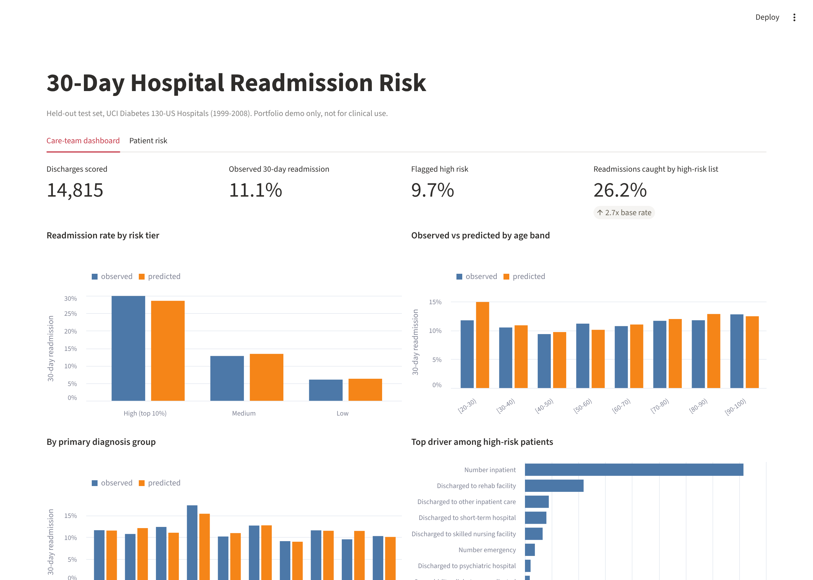
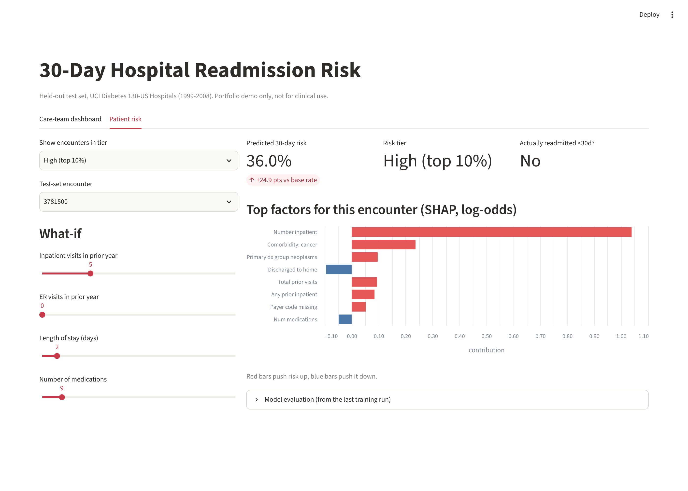

# 30-Day Hospital Readmission Risk

Which diabetic inpatients will be back in hospital within 30 days, and who should a care team
with limited time call first? Built on 101,766 real (de-identified) encounters from 130 US
hospitals, with SQL feature engineering, a patient-grouped evaluation, calibrated risk scores,
SHAP explanations, a fairness audit and a care-team dashboard.

> **Headline.** If a care team calls the riskiest 10% of discharges (1,482 calls on the
> 14,815-encounter test set), the model's list reaches **435 of 1,644 readmissions (26.5%)**,
> 2.65x the rate of calling at random and 64 more than a 3-feature baseline reaches with the same
> number of calls. Test AUROC **0.689** (95% CI 0.672-0.704) vs **0.619** for the baseline, on
> patients the model never saw in training.



## Why this problem
Under the CMS Hospital Readmissions Reduction Program, hospitals with excess readmissions lose
Medicare payment. Follow-up calls and early clinic visits help, but staff time is limited, so the
useful question is not "will this patient be readmitted?" but "who should we call first?" That is
why this project reports results **at a fixed outreach capacity (top 10%)**, not just AUROC.

## Run it
```bash
pip install -r requirements.txt
# put diabetic_data.csv and IDS_mapping.csv in data/raw/  (see data/README.md)
python run_pipeline.py              # features -> EDA -> train   (about 1 minute)
python -m scripts.feature_experiment   # optional, about 1 minute
streamlit run src/app.py            # dashboard + patient scoring app
```
`make smoke` (or the commands in the Makefile) runs everything on fake data to check your setup.

## Pipeline
```
diabetic_data.csv
  -> sql/01_load_and_clean.sql   explicit column types, cohort rules, audit counts     (DuckDB)
  -> sql/02_features.sql         ICD-9 grouping, comorbidity flags, prior utilization,  (DuckDB)
                                 medication changes, A1C testing
  -> sql/eda.sql                 exploratory questions -> reports/eda.md
  -> src/train.py                patient-grouped split, 4 models, calibration chosen on
                                 validation, patient-level bootstrap CIs, SHAP,
                                 subgroup audit, leakage check -> reports/, dashboard/
  -> src/app.py                  Streamlit care-team dashboard + what-if scoring
```

## Data and cohort
UCI "Diabetes 130-US Hospitals for Years 1999-2008" (Strack et al., 2014; CC BY 4.0).

| Step | Encounters |
|---|---|
| Raw file | 101,766 (71,518 patients) |
| Remove discharges to hospice or death (codes 11, 13, 14, 19-21): they cannot be readmitted | 99,343 |
| Remove 3 rows with invalid gender | **99,340** (69,987 patients) |
| 30-day readmissions in cohort | 11,314 (11.4%) |

Split 70/15/15 **by patient**: 69,702 train / 14,823 validation / 14,815 test encounters.

What the data showed before modeling (`reports/eda.md`):
- Readmission climbs steadily with prior-year inpatient stays: **8.6%** with none, **37.1%** with 5+.
- Where the patient goes matters: discharged home 9.3%, skilled nursing 14.7%, **rehab facility 27.7%**, psychiatric hospital 36.7%.
- **83%** of encounters had no HbA1c test, in a diabetic population.
- `weight` is 97% missing (dropped); `medical_specialty` 49% and `payer_code` 40% missing (kept, with "Missing" as its own category).
- `examide` and `citoglipton` are "No" in every row.

## Results (held-out test set, n = 14,815)
| Model | AUROC (95% CI) | PR-AUC (95% CI) | Brier | Top-10% precision | Top-10% recall | Lift |
|---|---|---|---|---|---|---|
| Prevalence only | 0.500 | 0.111 | 0.0987 | - | - | - |
| LogReg, 3 utilization counts | 0.619 (0.602-0.636) | 0.195 (0.171-0.222) | 0.0954 | 25.0% | 22.6% | 2.26x |
| LogReg, all features | 0.680 (0.664-0.696) | 0.224 (0.200-0.250) | 0.0939 | 27.1% | 24.4% | 2.44x |
| **XGBoost + Platt calibration (final)** | **0.689 (0.672-0.704)** | **0.251 (0.224-0.281)** | **0.0926** | **29.4%** | **26.5%** | **2.65x** |

CIs: 1,000 bootstrap resamples **of patients** (one patient's encounters are correlated).
The final model was chosen on validation AUROC (XGBoost 0.681 vs LogReg 0.663); the test set
was used once, for this table. Full output: `reports/RESULTS.md`.

**Reading this honestly.** An AUROC near 0.69 is typical for 30-day readmission from administrative
data; the model is a prioritization tool, not a diagnostic. Two takeaways matter more than the
AUROC: three prior-visit counts already capture most of the signal (0.619), and the full model's
gain shows up where it is used, at the top of the list.

**Risk tiers** (thresholds fixed on validation):

| Tier | Test encounters | Predicted risk | Observed 30-day readmission |
|---|---|---|---|
| High (top 10%) | 1,435 | 28.6% | 30.0% |
| Medium | 5,986 | 13.4% | 12.8% |
| Low | 7,394 | 6.3% | 6.1% |


### Calibration
A score a nurse reads as "30%" should mean about 30%. Platt scaling and isotonic regression were
compared by 2-fold patient-grouped cross-fitting **inside the validation set**; Platt won on log
loss (0.3300 vs 0.3317). Platt is monotonic, so it keeps the model's ranking; isotonic had created
tied scores that cost 0.012 PR-AUC in a first run. Predicted and observed rates agree within about
1.5 points in every tier.


## What drives risk


- **Prior inpatient stays** are the strongest driver by far, matching the EDA gradient.
- **Discharge destination** comes next: going home lowers risk; discharge to a rehab facility
  (code 22) raises it sharply.
- **Missing payer code** ranks 4th even though its raw readmission rate barely differs (11.7% vs
  11.2%). It is most likely a proxy for *which hospital* recorded the data, not a clinical factor;
  a model relying on it could break when deployed at a hospital with different data entry.
- **Longer stays get lower risk** in the model, which is counterintuitive and probably confounded
  with discharge destination. I would not act on that pattern without more analysis.

## Fairness audit (test set, `reports/subgroup_audit.csv`)
Race and gender are **not** model inputs; they are used only to check how the model behaves.

| Group | n | Observed | Predicted | AUROC | Recall at top-10% threshold |
|---|---|---|---|---|---|
| Caucasian | 11,093 | 11.5% | 11.4% | 0.688 | 26.9% |
| African American | 2,744 | 10.1% | 11.5% | 0.687 | 23.0% |
| Female | 8,129 | 11.3% | 11.6% | 0.691 | 27.3% |
| Male | 6,686 | 10.9% | 11.0% | 0.686 | 24.7% |
| Age 50-60 | 2,595 | 11.2% | 10.1% | 0.751 | 33.5% |
| Age 80-90 | 2,466 | 11.8% | 12.8% | 0.619 | 20.0% |
| Age 90-100 | 407 | 12.8% | 12.5% | 0.525 | 19.2% |

- Ranking quality is similar across race and gender, but **African American patients are
  over-predicted by 1.4 points yet have lower recall (23.0% vs 26.9%)**: fewer of their actual
  readmissions make the outreach list.
- **The model works poorly for the oldest patients** (AUROC 0.62 at 80-90, close to chance at
  90-100). Readmission in the very old is likely driven by things this data does not capture
  (frailty, social support). Small groups (90-100 has ~52 readmissions) carry wide uncertainty.
- In a real deployment I would review these patients by clinical judgment rather than the score,
  and monitor recall by group over time.

## What I tried that didn't work
**New features (`reports/feature_experiment.md`).** I added a comorbidity count, a "frequent flyer"
flag (3+ prior stays), an emergency-repeat flag, and a grouped discharge destination, then compared
them with 5-fold patient-grouped cross-validation on train+val (test untouched).
- The four extra features changed AUROC by **-0.0001**: the trees can already build them from
  existing columns. Not kept.
- Replacing the 26 raw discharge codes with 6 groups made things **worse in 5 of 5 folds**
  (AUROC -0.005, PR-AUC -0.010). My grouping put rehab (27.7% readmitted) and psychiatric
  transfers (36.7%) in the same bucket as nursing facilities (14.7%), erasing real signal.

## What broke
1. **DuckDB guessed the wrong column types.** `examide` and `citoglipton` are "No" in every row and
   `diabetesMed` is only Yes/No, so DuckDB's type inference read them as BOOLEAN, which broke the
   medication-count feature. Fixed by declaring explicit types for every text column at load.
2. **The leakage check didn't show what I expected.** I expected a random encounter-level split to
   inflate AUROC. It didn't (0.688 vs 0.689 grouped). Splitting that naive test set showed why the
   grouped split still matters:

   | Naive-split test encounters | n | 30-day rate | AUROC |
   |---|---|---|---|
   | Patient also in training | 6,297 | 20.3% | 0.575 |
   | Patient never seen | 8,537 | 4.6% | 0.729 |

   Patients with several encounters are readmitted **4x as often**, because a readmission *is* a
   second encounter. So "how many times does this patient appear in the file" is nearly the label.
   I deliberately did **not** build a feature from a patient's other encounters in the dataset:
   it would leak the outcome, and the file does not document that encounter IDs are chronological.
3. **Isotonic calibration hurt ranking** (ties), see Calibration above. Replaced by a
   validation-based choice, which picked Platt.
4. **My first top-10% comparison was unfair.** A quantile cut-off flagged more than 10% for the
   baseline, whose scores have many ties, making its recall look *higher* than XGBoost's. Fixed by
   flagging exactly the top 10% by rank for every model.

## Limitations
- Data is from 1999-2008; care patterns and coding (ICD-9 -> ICD-10) have changed.
- Readmissions to other hospitals are not captured; no timestamps, so no temporal validation.
- Single dataset, not validated prospectively. Portfolio project, not a clinical tool.

## App
`streamlit run src/app.py`
- **Care-team dashboard:** KPIs, observed vs predicted by tier / age / diagnosis, top drivers,
  and the ranked outreach list.
- **Patient risk:** calibrated risk, tier and SHAP drivers for one encounter, with what-if sliders.



`dashboard/scored_test_encounters.csv` (one row per test encounter with risk, tier and top 3
drivers) can also feed Tableau or Power BI; see `dashboard/README.md`.

## Repo map
```
sql/        01 load + cohort, 02 features, eda queries          (DuckDB)
src/        config, build_features, train, calibration, app
scripts/    run_eda, feature_experiment, smoke-test data generator
reports/    RESULTS.md, eda.md, feature_experiment.md, metrics.json, audits, figures
dashboard/  scored test-set extract + Tableau/Power BI notes
docs/       INTERVIEW_PREP.md
```
