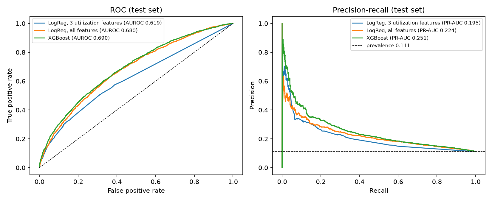
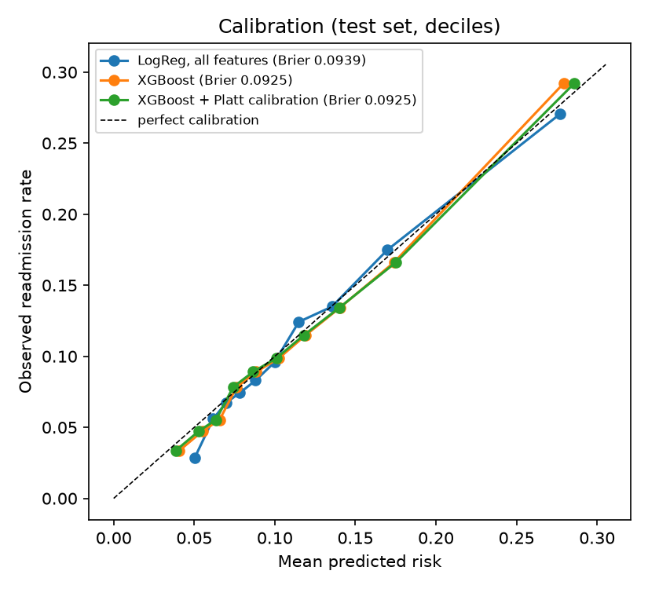
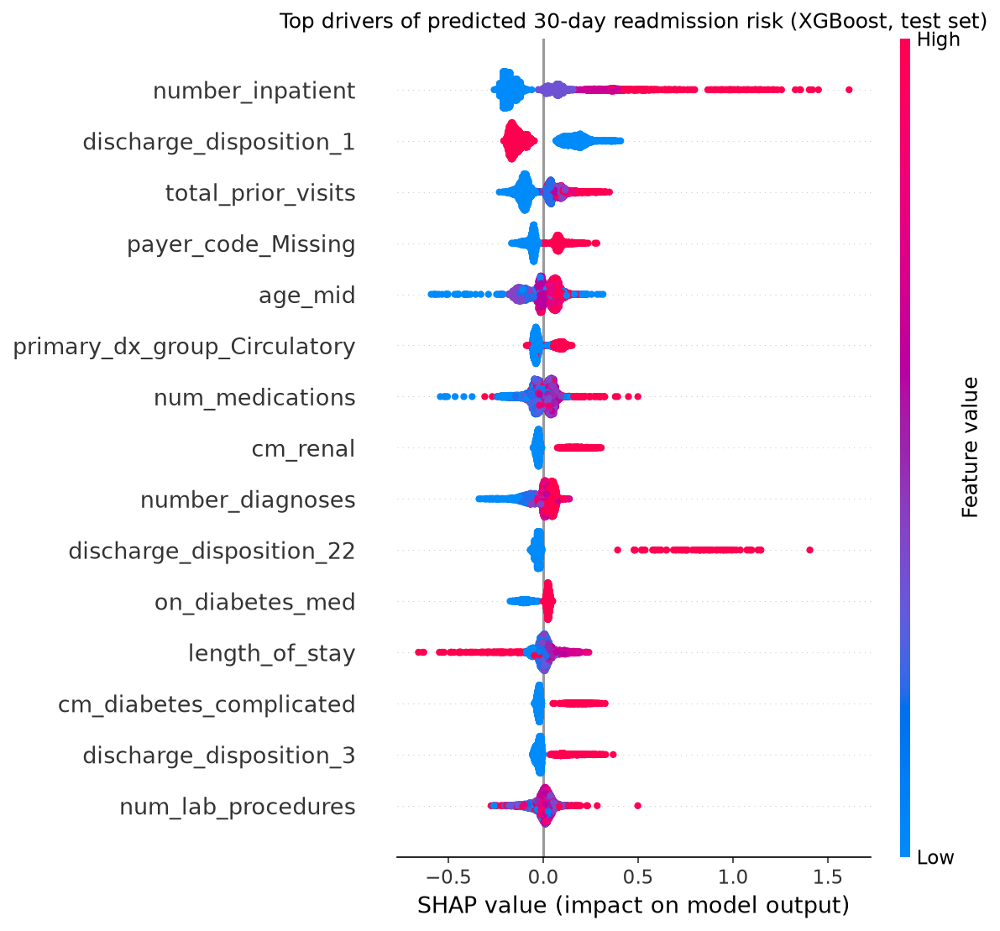

# 30-Day Hospital Readmission Risk

Predicts which diabetic inpatients will be readmitted within 30 days of discharge, so a care team
with limited follow-up capacity knows who to call first. Built on ~100k real (de-identified)
encounters from 130 US hospitals.

> **Headline** *(fill in from `reports/RESULTS.md` after your run - every number below must come from there)*
> Calling the riskiest 10% of discharges flagged by the model reaches **[X]%** of all 30-day
> readmissions, **[Y]x** the rate of calling at random. Test AUROC **[A]** (95% CI [a-b]) vs
> **[B]** for a 3-feature baseline, n = [N] held-out encounters from patients the model never saw.



## Why this problem
Under the CMS Hospital Readmissions Reduction Program, hospitals with excess readmissions lose
Medicare payment. Follow-up calls and early clinic visits help, but staff time is limited, so the
useful question is not "will this patient be readmitted?" but "who should we call first?" That is
why this project reports precision and recall **at a fixed outreach capacity (top 10%)** alongside AUROC.

## Run it
```bash
pip install -r requirements.txt
# download diabetic_data.csv into data/raw/  (see data/README.md)
make all          # or: python run_pipeline.py
make app          # or: streamlit run src/app.py
```
`make smoke` runs the full pipeline on fake data in under a minute to check your setup.

## Pipeline
```
diabetic_data.csv
  -> sql/01_load_and_clean.sql   cohort rules + audit counts            (DuckDB)
  -> sql/02_features.sql         ICD-9 grouping, comorbidity flags,      (DuckDB)
                                 utilization, medication changes
  -> src/train.py                patient-grouped split, 4 models,
                                 isotonic calibration, bootstrap CIs,
                                 SHAP, subgroup audit, leakage check
  -> reports/  dashboard/  models/
  -> src/app.py                  Streamlit scoring + what-if demo
```

## Method decisions (and why)
| Decision | Why |
|---|---|
| Removed discharges to hospice or death | They cannot be readmitted; keeping them inflates performance. Counts in `reports/cohort_audit.csv`. |
| **Split by patient, not encounter** | Many patients have several encounters. See "What broke" below. |
| Race and gender excluded from model inputs | Kept only for the fairness audit, so the audit can check whether the model behaves differently across groups without using group membership directly. |
| Final model chosen on validation, threshold set on validation | The test set is touched once, for reporting. |
| Isotonic calibration fitted on validation | A risk score a nurse reads as "23%" should mean ~23%. Calibration plot below. |
| 95% CIs by patient-level bootstrap | One patient's encounters are correlated; resampling encounters would understate uncertainty. |

## Results
*(Paste the table from `reports/RESULTS.md`.)*

| Model | AUROC (95% CI) | PR-AUC (95% CI) | Brier | Top-10% recall | Lift |
|---|---|---|---|---|---|
| Prevalence only | 0.500 | [ ] | [ ] | - | - |
| LogReg, 3 utilization features | [ ] | [ ] | [ ] | [ ] | [ ] |
| LogReg, all features | [ ] | [ ] | [ ] | [ ] | [ ] |
| XGBoost + isotonic calibration | [ ] | [ ] | [ ] | [ ] | [ ] |

**Read this honestly.** 30-day readmission is hard to predict from administrative data; published
models on this dataset typically land in the mid-0.6 AUROC range. The interesting result is not
the AUROC, it is how much the full model adds over 3 utilization counts and what it means at a
realistic outreach capacity.



## What drives risk

*(2-3 sentences in your own words: which features matter most and whether that makes clinical sense.)*

## Fairness audit
`reports/subgroup_audit.csv` - AUROC, calibration (observed vs predicted rate) and recall at the
global threshold, by race, gender and age band. *(Summarize: where does the model under- or
over-predict, and for which group is recall lowest?)*

## What broke
1. **Encounter-level splitting leaked patients.** *(Fill from the "Leakage check" section of
   RESULTS.md: X% of test encounters belonged to patients already in training, and AUROC moved from
   [grouped] to [naive].)*
2. *(Add anything else that went wrong while you built it - a feature that turned out to leak, a
   calibration problem, a subgroup that surprised you. This section is what interviewers read.)*

## Limitations
- Data is from 1999-2008; care patterns and coding (ICD-9 -> ICD-10) have changed since.
- Readmissions to other hospitals are not captured.
- No timestamps, so "prior visits" are as recorded by the source system and the split cannot be temporal.
- Not validated prospectively. Portfolio project, not a clinical tool.

## Dashboard
`dashboard/scored_test_encounters.csv` (one row per held-out encounter with risk, tier and top 3
drivers) feeds the Tableau/Power BI dashboard. Screenshot: *(add)*. Build notes: `dashboard/README.md`.

## Repo map
```
sql/            feature engineering in DuckDB SQL
src/            config, build_features, train, app
scripts/        smoke-test data generator (fake data, pipeline check only)
reports/        RESULTS.md, metrics.json, cohort audit, subgroup audit, figures
dashboard/      scored extract + dashboard build notes
docs/           build guide
```
